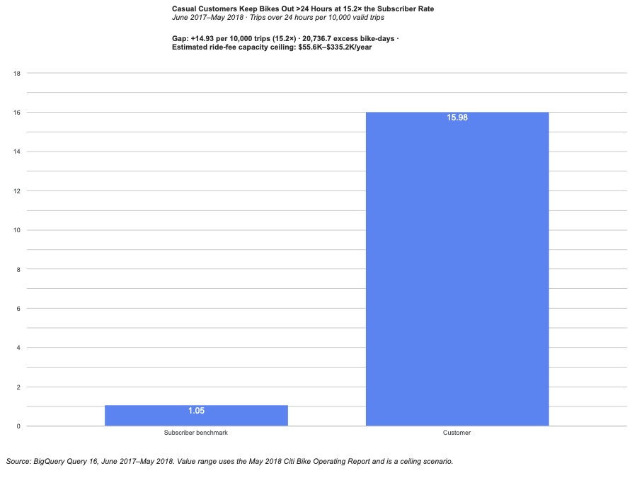
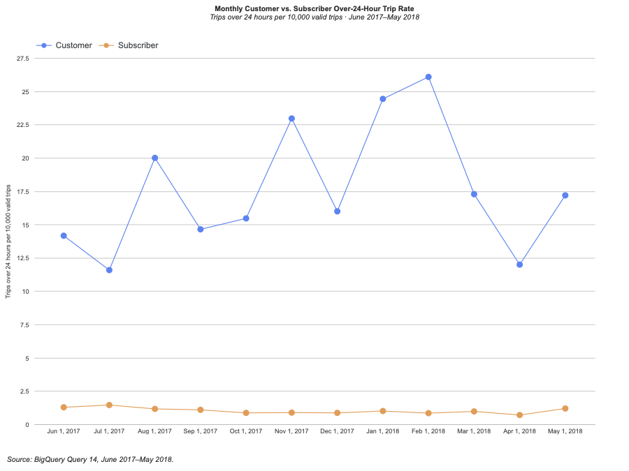

# Findings

*Updated 2026-11-09. Descriptive findings and CP1 gap, benchmark, and valuation use Queries 01–16. The primary comparison and supplementary monthly charts are embedded below; Riley’s chart check is recorded in audit entry #10.*

Use this file to explain what the evidence establishes. The [charter](charter.md) defines the evolving question and scope; the [SQL guide](sql/README.md) records how results were produced. Riley Allen leads the project, with the agent acting as a consultant.

## Descriptive context

The following descriptive baselines were established through queries executed on 2026-11-05 (see [sql/README.md](sql/README.md) for query details and verification):

1. **Total Population and Valid Trips:**
   * The `citibike_trips` table contains 58,937,715 total rows.
   * Exactly 5,828,994 rows (~9.9%) have a null `starttime`. [02_blank_rows_field_check.sql](sql/02_blank_rows_field_check.sql) and [03_blank_rows_usertype_check.sql](sql/03_blank_rows_usertype_check.sql) show these rows are blank on every field checked: `stoptime`, `tripduration`, `start_station_id`, `end_station_id`, and `bikeid` are all null, and `usertype` is a 0-length empty string. Station names, coordinates, `birth_year`, `gender`, and `customer_plan` were not checked. Filtering `WHERE starttime IS NOT NULL` leaves 53,108,721 trip records. This filter is approved cleaning rule C1 ([decisions.md](decisions.md#approved-cleaning-rules)).
2. **Seasonality and Growth:**
   * Monthly volume is strongly seasonal. The peak month was October in 2013 and 2017, September in 2015 and 2016, and July in 2014. The low point is January or February each year.
   * Peak-month volume grew from about 1.0M trips (2013) to about 1.9M (October 2017) ([01_monthly_trips_and_missing_starts.sql](sql/01_monthly_trips_and_missing_starts.sql)).
   * **Coverage limits:** The table has no trips from October 2016 through March 2017 (6 months). 2013 covers July–December only, and 2018 covers January–May only. As a result, yearly totals and yearly shares for 2013, 2016, 2017, and 2018 cover different months and are not directly comparable.
3. **Stations Snapshot Boundary:**
   * The `citibike_stations` table contains 2,518 unique stations with an average capacity of 29.7 docks ([04_stations_snapshot_profile.sql](sql/04_stations_snapshot_profile.sql)).
   * The table is a live modern snapshot (latest report November 4, 2026) and cannot be assumed to reflect historical 2013–2018 capacity or network layout.
4. **Rider Composition:**
   * All 53,108,721 valid trips fall into exactly two user categories: `Subscriber` and `Customer` ([05_usertype_annual_composition.sql](sql/05_usertype_annual_composition.sql)).
   * Across all valid trips, Subscribers account for 88.3% and Customers 11.7%. The Customer share by year was: 2013 13.2%, 2014 9.8%, 2015 13.2%, 2016 12.0%, 2017 11.9%, 2018 8.9%. Because of the coverage limits in Finding 2, yearly shares are not directly comparable. The low 2018 share covers only January–May.
5. **Trip Duration Benchmarks:**
   * Typical rides are short utility trips: the median duration is 10.5 minutes (627 seconds), with 50% of all trips between 6.4 and 17.7 minutes ([06_duration_benchmarks.sql](sql/06_duration_benchmarks.sql)).
   * 99% of all trips conclude in under 62.3 minutes. The minimum duration is 60 seconds (no sub-minute trips exist).
   * A small fraction (11,513 trips, ~0.02%) exceeds 24 hours, extending up to ~226 days and pulling the mean duration to 16.0 minutes.
   * Percentiles come from BigQuery's `APPROX_QUANTILES`, so they are approximate. The 60-second minimum suggests the source filtered out shorter trips, but the documentation does not confirm this.
6. **Duration Differences by Rider Type:**
   * Annual Subscribers take shorter, commuter-timed rides: median duration is 9.7 minutes, with 99% under 43.8 minutes ([07_duration_by_usertype.sql](sql/07_duration_by_usertype.sql)).
   * Casual Customers take rides more than twice as long: median duration is 20.9 minutes, with the 99th percentile reaching 183.9 minutes (~3.1 hours).
   * Casual Customers account for 51.1% of all multi-day trips exceeding 24 hours (5,880 of 11,513), despite making up only 11.7% of all trips. A Customer ride is ~8 times more likely to exceed 24 hours than a Subscriber ride (0.095% vs 0.012%).
7. **Weekday vs. Weekend Demand Dynamics:**
   * Subscribers dominate weekday commuter hours, peaking mid-week on Wednesday at 7.77M trips and dropping ~35% on weekends ([08_day_of_week_usertype.sql](sql/08_day_of_week_usertype.sql)).
   * Casual Customers surge on weekends: 45.8% of all casual Customer trips occur on Saturday and Sunday alone. Customer share jumps from 7.3%–7.7% on mid-week days to over 22% on weekends.
8. **Route Concentration and Leisure Loops:**
   * 6 of the top 10 most frequent routes in the network are round-trip loops where the bike returns to the origin station ([09_top_routes_roundtrips.sql](sql/09_top_routes_roundtrips.sql)).
   * The two most frequent routes are round trips at Central Park South stations (`Central Park S & 6 Ave`, 55,703 trips; `Grand Army Plaza & Central Park S`, 25,573), with mean durations of 47–54 minutes. In contrast, the two Chelsea point-to-point routes in the top 10 have mean durations of 5–7 minutes.
   * These are means, so a few multi-day trips can raise them. Routes are grouped by station name, and name changes over time could split or merge counts.
9. **Rider Demographics (Gender and Birth Year):**
   * All 53.1M valid trips fall into three gender categories: `male` (67.1%), `female` (21.4%), and `unknown` (11.5%) ([10_demographics_gender_birthyear.sql](sql/10_demographics_gender_birthyear.sql)).
   * The `unknown` group is largely missing data: 91% of its 6.1M trips have a null `birth_year`. These may be mostly casual Customers, but that has not been tested by a query.
   * Male and female riders are well-covered: about 99.9% of their trips have a birth year from 1900–2000. A further 11,873 trips across all groups list 2001–2002 and fall outside both the plausible and implausible counts. Average birth years are 1977 (male) and 1979 (female), roughly 36–38 years old at the study midpoint.
   * A small number of implausible birth years exist (entries before 1900 across all groups). These should be flagged as a potential cleaning decision before any age-based analysis.
10. **Hourly Rush-Hour Patterns:**
   * Subscriber trips form a sharp double peak at **8 AM (4.0M trips)** and **5 PM (4.7M trips)** — consistent with morning and evening commuting ([11_hourly_rush_hour_patterns.sql](sql/11_hourly_rush_hour_patterns.sql)).
   * 5 PM is the single busiest hour in the network overall (5.2M total trips).
   * Casual Customer volume builds gradually from mid-morning and peaks in the **early-to-mid afternoon (2–4 PM)** with no commute spike, consistent with recreational use.
   * From midnight through 4:59 AM, Subscribers make up 85.6%–89.7% of trips in each hour. Total volume is lowest in the 3 AM hour (99,089 trips) and the 4 AM hour (94,279), then rises in the 5 AM hour (297,710).
11. **Station Traffic Concentration:**
   * No single station dominates the network. The busiest station by combined activity (`E 17 St & Broadway`) accounts for 0.80% of all departures; the station with the most departures (`Pershing Square North`) accounts for 0.82%. Together, the top 20 stations account for 12.6% of departures ([12_station_traffic_concentration.sql](sql/12_station_traffic_concentration.sql)).
   * Over the full period, departures and arrivals at each top-20 station differ by no more than about 10% (largest gap: `8 Ave & W 31 St`). These are five-year totals, so they cannot show whether bikes pile up or run short at certain hours or on certain days.
   * The heaviest activity concentrates in Midtown West, Flatiron/Union Square, and the Hudson River waterfront — consistent with the commuter and tourist patterns identified in earlier queries.

## The gap

**Measured gap (June 2017–May 2018):** Customers had 15.98 trips over 24 hours per 10,000 valid trips, compared with 1.05 for Subscribers—a gap of 14.93 per 10,000, or 15.2×. In Query 16, each output row represents one rider type across the full period; each source row represents one valid trip.

| Element | Approved definition and result |
|---|---|
| Business problem and decision | Casual `Customer` riders keep Citi Bikes out over 24 hours far more often than `Subscriber` riders, tying up fleet capacity. Supports an operations manager deciding whether to target pre-24h return reminders or station messaging at casual riders ([charter.md](charter.md)). |
| Business KPI and formula | **Trips over 24 hours per 10,000 valid trips:** `COUNTIF(tripduration > 86400) * 10000.0 / COUNT(*)`, paired with **bike-days tied up:** `SUM(IF(tripduration > 86400, tripduration, 0)) / 86400.0`. |
| Source row, output row, and period | Source row: one valid trip (`starttime IS NOT NULL`, rule C1) in June 2017–May 2018 (rule C2). Query 16 output: one row per rider type for the full period (2 rows). Query 14 output: one row per rider type per month (106 rows overall; 24 for the selected period). |
| Observed Customer performance | **`15.98` >24h trips per 10,000 valid trips** (`2,883` of `1,804,498` Customer trips), tying up **`21,733.4` bike-days** (`7.54` days per >24h trip). Customers are `10.65%` of valid trips but `64.4%` of >24h trips and `72.2%` of >24h bike-days. |
| Supporting checks | [13_over_24h_timestamp_duplicate_check.sql](sql/13_over_24h_timestamp_duplicate_check.sql) confirmed 0 missing stop times, 0 negative durations, and 0 duplicates among >24h rows; June 2017–May 2018 avoids the Oct 2016–Mar 2017 coverage gap and the 2014–2015 zero->24h months. |

## The benchmark

- **Benchmark group and rationale:** Annual `Subscriber` trips during the exact same 12-month window (June 2017–May 2018: `15,146,532` valid trips, `89.35%` of volume; [16_period_gap_summary.sql](sql/16_period_gap_summary.sql)). Subscribers ride the same docks under the same weather and 24-hour lost-bike policy, controlling for seasonality and network changes.
- **Benchmark level:** **`1.05` >24h trips per 10,000 valid trips** (`1,591` >24h trips), tying up **`8,366.3` bike-days** (`5.52` bike-days per 10,000 trips; `5.26` days per >24h trip).
- **Measured gap vs. benchmark:**
  - **Rate gap:** `15.98 − 1.05 = +14.93` >24h trips per 10,000 valid trips (**`15.2×`** the Subscriber rate), or **`2,693` excess >24h trips/year** above the ~`190` expected if Customers matched the Subscriber rate.
  - **Capacity gap:** At the Subscriber bike-day rate (`8,366.3 / 15,146,532` bike-days/trip), `1,804,498` Customer trips would tie up **`996.7` bike-days** instead of `21,733.4` — an excess of **`20,736.7` bike-days/year** (~`56.8` bikes unavailable on an average day).
- **Comparability limits:** Subscribers are repeat local riders with 45-minute included windows and stored member accounts, whereas Customers buy short-term passes (30-minute window, heavy weekend/leisure mix). The Subscriber rate is an operational benchmark, not proof that casual riders can reach identical compliance.

## Value

Using approved valuation rule V1 ([decisions.md](decisions.md#approved-valuation-rule)), we value the annual capacity tied up by excess Customer >24h lockups (June 2017–May 2018) as an **upper-bound ceiling range of ~$55.6K to ~$335.2K per year**:

1. **Excess bike-days tied up:** `21,733.4` actual Customer >24h bike-days − `996.7` Subscriber-benchmark bike-days = **`20,736.7` excess bike-days/year** ([16_period_gap_summary.sql](sql/16_period_gap_summary.sql)).
2. **Potential ride capacity:** Active bikes averaged **`6.29` trips per active bike-day** (`16,951,030` valid trips ÷ `2,695,579` active bike-days; [15_trips_per_active_bike_day.sql](sql/15_trips_per_active_bike_day.sql)), giving `20,736.7 × 6.29 = 130,434` potential rides/year.
3. **Sourced per-trip fee proxies:** From Motivate's **May 2018 Citi Bike Monthly Operating Report** to NYC DOT (https://citibikenyc.com/system-data/operating-reports; human-verified in [audit #8](Other/audit_log.md)):
   - **Direct casual-pass ceiling (lower bound):** Only `10.65%` of period trips are casual `Customer` rides (`89.35%` are flat-fee Annual Subscribers), and May 2018 Casual Membership fees averaged **`$4.00` per casual trip** (`$967,811.98 ÷ 242,035` casual trips, before overages): `130,434 × 10.65% × $4.00 = $55,565` (**~$55.6K/year**).
   - **System-wide ride-fee ceiling (upper bound):** Valuing all `130,434` rides at May 2018 system-wide Membership & User Fees of **`$2.57` per trip** (`$4,681,279.07 ÷ 1,824,476` total trips): `130,434 × $2.57 = $335,215` (**~$335.2K/year**).

**Assumptions and unresolved evidence limits:**
- **Capacity ceilings, not net savings:** `6.29` trips/bike-day counts only bikes ridden at least once that day (above full-fleet turnover), and a tied-up bike causes a lost trip only when docks actually run empty.
- **Single-month revenue proxy:** Dollar per-trip averages come from May 2018; pass mix varies across seasons (and Citi Bike's `$3` Single Ride launched only in April 2018).
- **Unobserved overage and recovery cash flows:** BigQuery trip logs do not record billing. Citi Bike charged overtime fees and up to `$1,200` for bikes unreturned past 24 hours (total casual overages across all durations were `$522,543.04` in May 2018), so net financial loss depends on internal fee-collection and bike-replacement records unavailable in the public dataset.

## Chart

**Primary CP1 chart:** Period-level Customer versus Subscriber benchmark comparison.

**Supplementary monthly trend:** Monthly over-24-hour rates by rider type for the same period.

Every chart must use consistent definitions, units, populations, and periods, with traceable source queries or calculations.

## Interpretation, recommendations, and limits

- **Proposed interpretation (not a causal proof):** Casual riders exceed 24 hours at `15.2×` the Subscriber rate likely because short-term pass users are less familiar with dock-locking confirmation and 30-minute/24-hour return rules — an operational hypothesis that trip timestamps alone cannot prove.
- **Management decision framing (recommendations still open):** The `~$55.6K–$335.2K/year` ceiling supports testing low-cost interventions (such as automated pre-24h app/SMS return alerts for casual passes or dock-check prompts at top lockup stations) rather than high-cost hardware changes, while checking internal overage recovery first. Specific station targeting remains open pending a station-level breakdown.

Respect the approved 2013-2018 scope and explain source applicability. The [supplied documentation](Other/metadata.pdf), [ERD](Other/ERD.pdf), and [source notes](Other/dataset_documentation.md) provide context; their reported profile results are not automatically verified project findings.

## Updating this file

When queries are uploaded, follow the [uploaded-query SOP](sql/README.md#uploaded-query-sop). The agent explains supplied evidence, discusses interpretations, and proposes exact changes for the project lead's approval. Git publishing requires separate approval.
